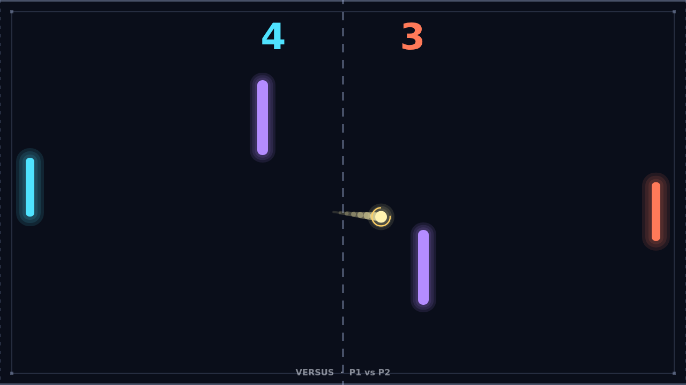
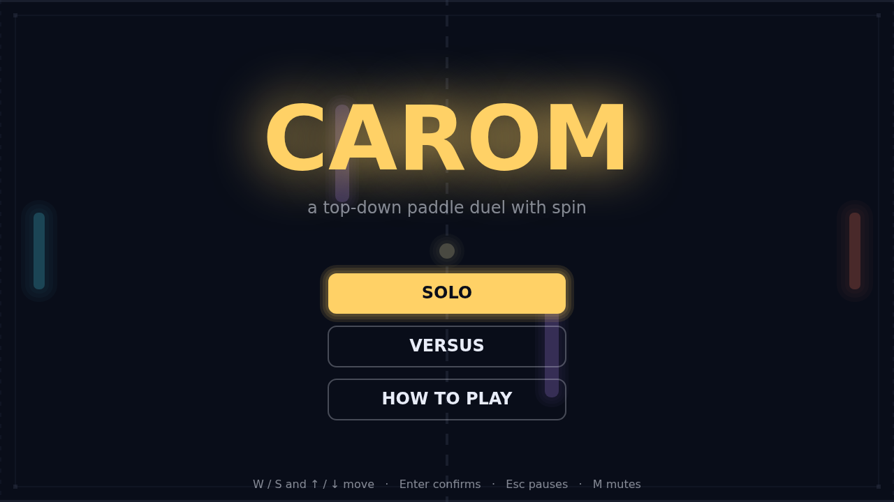

# Carom

Carom is a paddle duel played from above. Your paddle guards one edge of a dark
field, your opponent's guards the other, and a ball ricochets between you, off
the top and bottom walls and off the two bars standing in the middle of the
court. Let it slip past you and your opponent takes the point. First to eleven
wins, but only by two: at ten all, the match runs on until someone pulls ahead.

Every match opens the same way. The ball waits at the center while a ring
tightens around it, then it leaves toward whoever was last scored on. The
opening rally is a feeling-out: slow serves, easy returns, each player learning
how far the other reaches. Then the ball picks up speed. Every paddle hit adds a
little more, until the field is a blur of trail and the ball is crossing it in
well under a second.

The spin is what turns Carom from a reflex test into a game of intent. Strike the
ball while your paddle is sliding and the ball leaves with a curve: slide down as
you hit and it bends clockwise, slide up and it bends the other way. The curve is
strongest right after the hit and fades over the flight, so a hard, late flick
sends the ball arcing around the near obstacle before it straightens out and dives
for the far corner. A still paddle sends it straight, which is sometimes exactly
what you want.

The two bars make the whole field a bank-shot problem. A ball that would have
sailed harmlessly to your opponent's paddle can be bent into a bar and sent back
at them from a direction they were not guarding. The same bars punish a lazy
return, though: a straight shot into one comes right back at you. The best
rallies are the ones where both players are playing the walls and the bars
together, reading the curve of the trail to guess where the next bounce lands.

Play solo against the AI, which tracks the ball with a human-sized reaction lag
and a top speed you can outrun, or sit a friend at the arrow keys and play
versus on the same keyboard. Match point in a close versus game, with the ball
spinning off a bar and both of you scrambling, is the moment Carom is built for.
